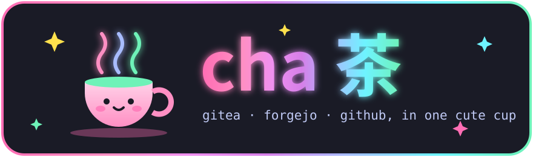
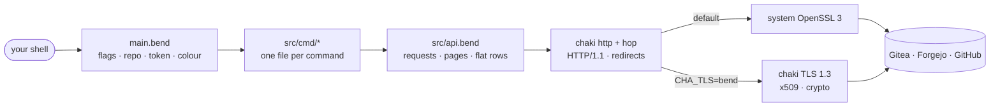
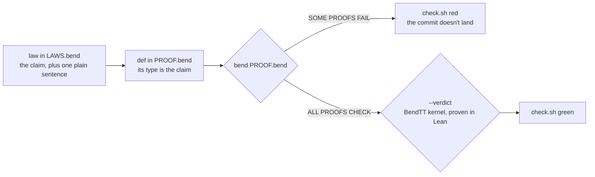

<p align="center">
  
</p>

<p align="center">
  
  
  
  
</p>

<p align="center"><b>A forge CLI for Gitea, Forgejo and GitHub.</b><br>
One binary. No <code>gh</code>, no <code>tea</code>, not even <code>git</code>.</p>

---

## ☕ Usage

```console
$ cha issue list
$ cha pr view 42 --comments
$ cha runs logs 1337 --failed
$ cha runs watch 1337
$ cha search issues kettle --owner bendlang
$ cha packages --type container
$ cha moved --since 1d
```

> 🫖 **Early days.** The commands above work today. See the [agent skill](skills/cha/SKILL.md) for supported flags, [how a command flows](docs/how.md) for the path from shell to forge, and the [roadmap](docs/roadmap.md) for the next priorities.

## 📦 Install

**Arch Linux**: `packaging/arch/PKGBUILD` builds cha from source with a pinned Bend toolchain, or grab the package from the [latest release](https://github.com/mintktkr/cha/releases/latest):

```console
$ cd packaging/arch && makepkg -si
```

**From source**: install [Bend](https://bend-lang.com) 2.0.39 and clang, then:

```console
$ bend main.bend -o cha && install -m755 cha ~/.local/bin/
$ cha completions fish > ~/.config/fish/completions/cha.fish
```

**For your agents**: `skills/cha/SKILL.md` teaches coding agents how to use cha. Link it where they look for skills, for example `ln -s $PWD/skills/cha ~/.agents/skills/cha`. The Arch package installs it to `/usr/share/cha/skills/cha`.

## 🌸 Why

- **One tool for every forge.** The same commands work against a self-hosted Gitea and against github.com. cha reads the host and repo from the current checkout's remote.
- **Made for agents too.** Much of the time a coding agent runs `cha`, so:
  - it never opens an editor. Bodies come from stdin or a file
  - piped output is plain text, with no escape codes
  - `--json` gives stable fields, `--json a,b` only those
  - exit codes mean something
  - an unknown flag is an error that lists the flags the command takes, never silently ignored, and so is a flag left without its value
- **Gitea Actions included.** List runs, read job logs, dispatch workflows, and rerun or cancel them where the forge's API has it (Gitea 1.26 for a rerun, 28 for a cancel).
- **Mirrors too.** `cha mirror` says whether a repo is a pull mirror and what it pushes to, and asks for a sync when you need one.
- **Nothing to install.** cha speaks HTTPS and JSON itself. Credentials come from git's credential store or an environment variable.

## 🌈 Colours

In a terminal, cha uses a pink → lavender → mint palette where every colour means something:

| | colour | meaning |
|---|---|---|
| 🩷 | pink `#ff6eb4` | failed |
| 🍋 | lemon `#ffe14d` | running |
| 🩵 | aqua `#6ef3ff` | commands, links |
| 🌿 | mint `#6ef2b8` | success, open |
| 💜 | lavender `#d67fe8` | merged |

`cha help` goes all out with glow, animation and kaomoji ✧･ﾟ: ･ﾟ✧. Piped, it prints plain text.

## ✨ Written in Bend, laws first

cha is written in [Bend](https://bend-lang.com), down to its own HTTP, JSON and TLS library, [chaki 茶器](lib/chaki/README.md). Nothing comes from a package hub.



Bend has **laws**: a claim about the code, written in the code, that the checker refuses until a proof exists. cha keeps **468** of them. A commit only lands while every one still proves:



- 🔐 a token, a webhook secret or a webhook URL's path and query never reach the output
- 🎨 with colour off, no escape byte is printed
- 🧭 an id or a ref can't walk out of its URL path
- ↪️ a redirect to another origin drops your credentials, and they stay dropped, even back at the first origin
- 🤝 TLS: no application data before the server's Finished, the certificate chain and its signature all check out, and a failed connection stays failed
- 🧾 every RFC 3986 resolution example, every published hash and cipher vector chaki claims, every UTF-8 edge

Laws over every input hold where the code is structural. Where it computes, a law pins exact answers instead. Writing chaki's 320 laws turned up five real bugs, from a TLS downgrade check to an HTTP request-smuggling shape. [docs/laws.md](docs/laws.md) explains how to read a law, the two kinds, every area and what they found. Promises about the *order* of events also have TLA+ models, with charts, in [verify/](verify/README.md).

## 💌 Contributing

Humans and agents are both welcome, under the same rules. Start with [CONTRIBUTING.md](CONTRIBUTING.md), then [AGENTS.md](AGENTS.md) for the details. Stuck? See [SUPPORT.md](SUPPORT.md). Found a vulnerability? Report it privately, see [SECURITY.md](SECURITY.md).

## 📜 License

[MIT](LICENSE) · made with ☕ at the bottom of the world 🐧
