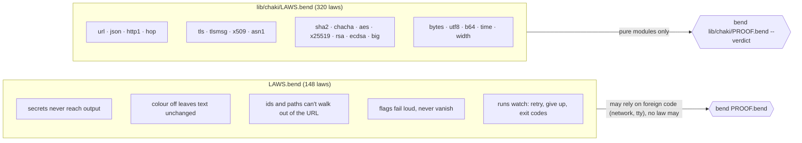

# The laws

cha is written in [Bend](https://bend-lang.com), and Bend has laws: a claim about the code, written in the code, that the checker refuses until a proof exists. A test checks the cases someone thought of. A law covers every input it quantifies over, or pins an exact answer that can never drift. Either way, a commit that breaks it doesn't land.

## What a law looks like

```python
# LAW: a hop to another origin carries no credentials: a request that sends AUTHORIZATION and
# Cookie reaches it as the same request without them.
law hop_cross_origin_drops_credentials:
  for +hs: List<&2, Http1.Field()>
  for +b: List<&2, U32>
  {Hop.judge.go(Hop.Hop{"GET", "http://a.example/x", ("AUTHORIZATION", "t") <> ("Cookie", "c") <> hs, b},
                Url.Url{"http", "a.example", 80, "/x"}, Url.Url{"http", "b.example", 80, "/y"}, 307)
   == Hop.judge.go(Hop.Hop{"GET", "http://a.example/x", hs, b}, ...) : Hop.Hop}
```

- **`law`** names the claim. The `# LAW:` line above it says it in plain words. That sentence is the spec: read it, and judge whether the claim says what it should.
- **`for`** quantifies. This one holds for every list of other headers `hs` and every body `b`.
- **`{a == b : T}`** is the claim itself: the two sides are equal.
- **The proof** lives in `PROOF.bend`, as a def of the same name whose type is the claim. Bend has no tactics. A proof is case analysis (`match`), induction (a recursive call), rewriting (`%e : P`), or plain computation (`{==}`, when both sides reduce to the same term). The proof of the law above is `{==}`: both sides normalize to the same header walk, for any `hs`.

## Two law files



- **`LAWS.bend`** holds cha's own promises. It imports commands that talk to the network, so `bend PROOF.bend` always lists the foreign defs those pull in. `scripts/check.sh` accepts that list only when no law or proof is on it.
- **`lib/chaki/LAWS.bend`** holds what chaki, cha's own library, promises. It imports only chaki's pure modules, so its gate is strict: exit 0 and `ALL PROOFS CHECK`, or red. `--verdict` rechecks every proof with BendTT, a small kernel that has its own proof in Lean (`CHAKI_VERDICT=1 scripts/check.sh`).

## Two kinds of law

| kind | when | example |
|---|---|---|
| **over every input** | the code is structural: lists, strings, a state machine | `hop_cross_origin_drops_credentials`, `tls_dead_absorbs` ("a failed connection stays failed, whatever bytes come next"), `x509v_name_exact_only_itself`, `bytes_rev_rev` |
| **known answer** | the answer goes through 32-bit arithmetic, or the input is a published test vector | `tlsmsg_serverhello_downgrade`, every RFC 3986 §5.4 resolution example, `sha2_sha256_abc`, `time_parse_refuses` (2023-02-29 is no date) |

Why two kinds: Bend's `U32` is a 32-bit word, and Base proves almost nothing about word arithmetic. A law over every number stops at the first symbolic comparison, so where the code computes, a law pins exact inputs instead: whole ranges, edges, the RFC's own vectors. A few known answers are too heavy for the kernel to recompute: a GCM vector, a 2048-bit RSA signature, a P-256 verify. Those stay as offline checks in `test/chaki_*_check.bend` and aren't laws.

## The laws by area

| area | laws | what they pin |
|---|---|---|
| url | 96 | parse, resolve (all of RFC 3986 §5.4), origin, percent-encoding, no `..` above the root |
| bytes, utf8, b64 | 44 | round trips, overlong and surrogate UTF-8 refused, RFC 4648 vectors, PEM |
| asn1, x509, x509v | 40 | strict DER lengths, wildcard hostnames (leftmost label only), expiry, CA and path-length rules |
| tlsmsg, tls | 29 | no application data before the handshake ends, a bad Finished or chain kills the connection, one HelloRetryRequest at most, record size and sequence numbers |
| big, rsa, ecdsa | 27 | word-boundary arithmetic, signatures out of range refused before any math, the exact PKCS#1 encoding |
| http1 | 19 | no CR or LF can reach a request line or header, both Transfer-Encoding and Content-Length refused, chunked bodies |
| sha2, chacha | 18 | FIPS 180-4 and RFC 8439 vectors, padding at 55 and 56 bytes, AEAD tampering refused |
| json | 15 | the writer's escaping reads back as the same string, malformed documents refused |
| time, width | 14 | calendar round trips, nonexistent dates refused, terminal widths |
| hop | 12 | redirects: credentials dropped across origins and stay dropped, https → http refused, 301/302/303 vs 307/308 |
| aes, x25519 | 6 | FIPS-197 vectors, GCM length refusals, RFC 7748 clamping |
| cha itself (`LAWS.bend`) | 148 | secrets, colour, flags, ids, paths, pull request and run commands |

## What the laws found

Writing chaki's laws first, on 2026-11-03, turned up five real bugs. Each is fixed, with a regression line in `test/`:

1. `url`: `resolve` kept the dot segments of a reference with its own authority (`http://a/b/../c`, `//h/a/./b`).
2. `tlsmsg`: a ServerHello carrying the TLS 1.2 downgrade sentinel was accepted (RFC 8446 §4.1.3).
3. `http1`: the request writer sent header names outside the token set (`X: Y`, a space, an empty name).
4. `http1`: a response with both Transfer-Encoding and Content-Length was accepted (RFC 9112 §6.3).
5. `http1`: a character past one byte in the request head went out as its low byte, unchecked.

## The models

Some promises are about the order of events, not one function: "no application data before the server's Finished is verified", "credentials never come back after a redirect drops them". Those also have TLA+ models in [`verify/`](../verify/README.md), checked with TLC against an adversarial server over every order of events. Each model rule was shown to fail on a deliberately broken copy. `verify/README.md` has the charts and maps each law to the model rule it backs.

## Adding one

1. Write the claim first, in the right file and section, with a `# LAW:` sentence a person can judge.
2. Write the code, then the proof in `PROOF.bend` (or `lib/chaki/PROOF.bend`), as `def Laws.<name>(...)`.
3. Run `scripts/check.sh`. A law that turns out false is a finding: fix the code, not the law.

Never weaken a law to make it prove. A claim narrowed until it says nothing is a changed spec, and that's the reader's call, not the prover's.
