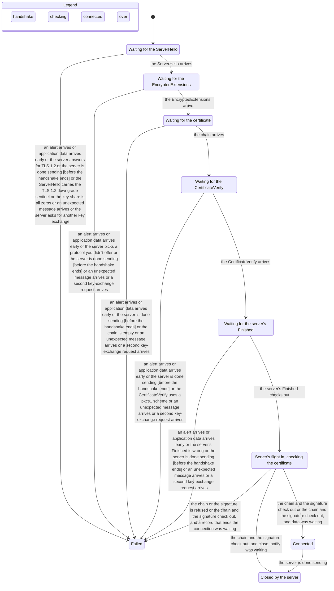
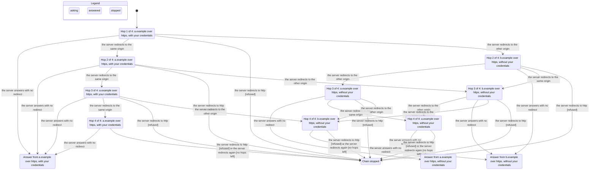

# verify

Two TLA+ models of the places where chaki's order of events is the security property: the TLS
1.3 client handshake and the redirect chain. Each folder holds the model (`.tla`), its TLC
config (`.cfg`) and the view module (`view.ts`, the words the chart uses). Each rule is one
`INVARIANT`; each action names, in a comment, the def it models.

Run them, and read the result, as `.pi/skills/verify-chaki/SKILL.md` says. The `out/` folders
are not committed: `tlc.out` and `report.md` carry TLC's local paths, pids and timestamps, so
they are regenerated per run and are in `.gitignore`. The charts below are the last run's.

Sync commit: **cf7905c**. Both models were confirmed against the code at that commit.

## TLS 1.3 client — 29 states, 97 steps

`verify/tls/Tls13Client.tla` covers the handshake of `lib/chaki/tls.bend`, the ServerHello
refusals of `lib/chaki/tlsmsg.bend` and the trust decision of `lib/chaki/tlsio.bend`, with the
server as an adversary that sends any message at any time. TLC reached 29 distinct states and
97 steps; every rule holds.

- `NoApplicationDataBeforeAllChecks` — no application data is handed to the caller, and none is
  sent, before the server's Finished, the certificate chain and the CertificateVerify have all
  been verified.
- `ConnectedOnlyAfterAllChecks` — the client says Connected only after those three hold.
- `ChecksInOrder` — the Finished first (it is what asks the shell), then the chain, then the
  leaf's signature.
- `FailedIsAbsorbing` — once the connection has failed, every later state is Failed.
- `AtMostOneHelloRetryRequest` — at most one HelloRetryRequest, because the first one ends the
  connection.

## Redirect chain — 27 states, 51 steps

`verify/redirect/Redirect.tla` covers the walk of `lib/chaki/http.bend` and the decisions it
asks `lib/chaki/hop.bend` for, over two origins, an https start and a hop budget of four. TLC
reached 27 distinct states and 51 steps; every rule holds. `test/verify_redirect_check.bend`
replays these hops through `judge` itself and runs in `scripts/check.sh`.

- `NoCredentialsToAnotherOrigin` — `authorization` and `cookie` are never sent to an origin
  other than the one the chain started at.
- `DroppedStaysDropped` — once dropped, they never come back, not even at the first origin.
- `NoHttpAfterHttps` — no request goes over http after an https start.
- `WithinHopBudget` — the chain does not outlive the hop budget; `walk`'s fuel refuses the next
  hop.

